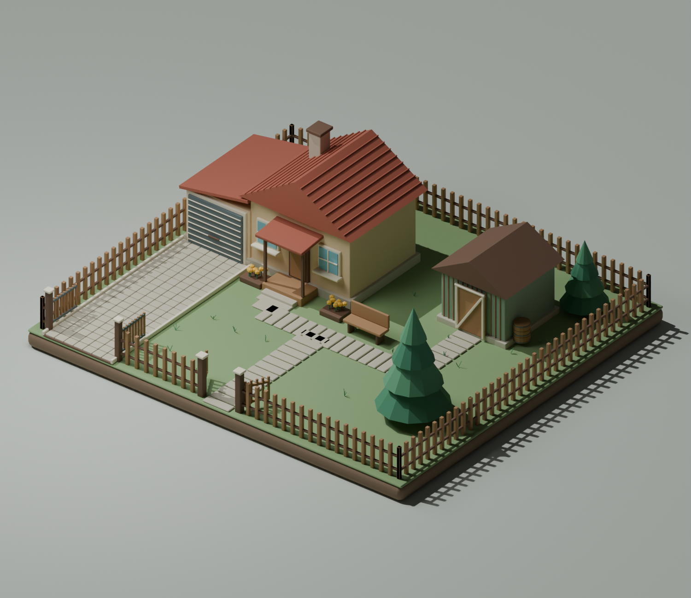

# Участок — проект Blender

Трёхмерная сцена участка с домом, дорожками и озеленением.



Откройте `uchastok.blend` в Blender для просмотра и редактирования сцены.

## Файлы

- `uchastok.blend` — готовая сцена.
- `uchastok_preview.png` — изображение сцены.
- `create_world.py` — создание сцены заново.
- `move_bench.py` — изменение положения скамейки.
- `finish_update.py` — изменение положения цветника и обновление превью.

Скрипты используют Python API Blender (`bpy`). Запускайте их через Blender, например:

```sh
blender --background --python create_world.py
```

Скрипты сохраняют сцену и превью в папку проекта. Скрипты изменения положения предназначены для соответствующего этапа редактирования; повторный запуск может повторно сдвинуть объекты или завершиться проверкой состояния.
